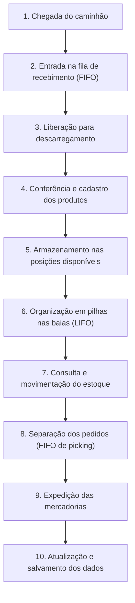

# 📦 Gerenciador de Logística e Depósito (WMS)

**Warehouse Management System — Documentação Técnica e de Planejamento**

| Campo | Detalhamento |
| :--- | :--- |
| **Equipe** | Alex Eduardo, Kauã Kevin, Denner Cardoso e Benjamim Saturno |
| **Disciplina** | Lógica de Programação — Projeto Prático |
| **Situação** | 🗒️ Em planejamento — **nenhuma funcionalidade implementada** |
| **Prazo** | 40 dias |
| **Linguagem** | **PHP** — definido pela equipe |
| **Interface** | Terminal (CLI) ou Web simplificada (HTML5 + CSS3, sem JavaScript) — modo pendente |
| **Persistência** | Arquivos `.txt`, `.csv` ou `.json` — sem banco de dados e sem SQL |

> ⚠️ Documento de **planejamento**: descreve o que a equipe **pretende desenvolver**, não o que está pronto. Marcadores usados no texto: 🔒 requisito obrigatório da especificação · 🧩 proposta sujeita à validação da equipe · 🔮 funcionalidade futura.

## 📋 Sumário

1. [Apresentação do Projeto](#1-apresentação-do-projeto)
2. [Objetivos do Sistema](#2-objetivos-do-sistema)
3. [Funcionalidades do Sistema](#3-funcionalidades-do-sistema)
4. [Estruturas de Dados Utilizadas](#4-estruturas-de-dados-utilizadas)
5. [Fluxo de Funcionamento](#5-fluxo-de-funcionamento)
6. [Organização dos Módulos](#6-organização-dos-módulos)
7. [Divisão de Responsabilidades da Equipe](#7-divisão-de-responsabilidades-da-equipe)
8. [Regras de Negócio](#8-regras-de-negócio)

---

## 1. Apresentação do Projeto

**WMS** (*Warehouse Management System* — Sistema de Gerenciamento de Armazém) é o software que controla as operações de um galpão logístico: o que entra, onde cada item está guardado, como os produtos se movem e o que sai. Funciona como o **"mapa vivo" do depósito**.

**Problema a resolver:** no controle manual, produtos se perdem nas prateleiras, caminhões chegam sem ordem de atendimento, caixas são retiradas do meio das pilhas, o estoque fica desatualizado e os inventários demoram. O WMS digitaliza cada etapa com estruturas de dados que reproduzem o comportamento físico do depósito.

**Objetivo:** simular o ciclo logístico completo — recebimento, armazenamento, movimentação, separação e expedição — usando estruturas de dados nativas e persistência em arquivos, **sem banco de dados**.

**Como funciona a simulação:** cada elemento real do depósito tem um equivalente digital:

| Elemento real | Representação no sistema | Estrutura |
| :--- | :--- | :--- |
| Corredores / alamedas | Linhas da matriz do galpão | Matriz 2D |
| Prateleiras / posições | Colunas da matriz | Matriz 2D |
| Caixas empilhadas nas baias | Pilha de produtos | Pilha (LIFO) |
| Caminhões na doca / pedidos pendentes | Filas de atendimento | Fila (FIFO) |
| Catálogo de mercadorias | Vetor de cadastro | Vetor (1D) |
| Estado do depósito entre execuções | Arquivos de dados | Persistência |

## 2. Objetivos do Sistema

**Objetivo geral:** controlar a entrada, a localização, a movimentação e a saída de produtos de um depósito por meio de estruturas de dados nativas e persistência em arquivos, sem qualquer banco de dados.

**Objetivos específicos:**

- **OE01 — Catálogo:** manter o cadastro de produtos (SKU, descrição, categoria, preço, lote, quantidade);
- **OE02 — Recebimento:** organizar os caminhões em fila FIFO na doca, na ordem de chegada;
- **OE03 — Mapa:** representar o galpão como matriz bidimensional (corredores × posições);
- **OE04 — Empilhamento:** guardar caixas em pilhas LIFO dentro das baias;
- **OE05 — Localização:** busca linear e binária por SKU, informando a posição física do item;
- **OE06 — Ordenação:** inventário ordenado por preço, lote ou quantidade (Bubble Sort / QuickSort);
- **OE07 — Movimentação:** transferir produtos entre posições, atualizando origem e destino;
- **OE08 — Pedidos:** fila FIFO de separação (*picking*) e expedição das mercadorias;
- **OE09 — Relatórios:** inventário completo, ocupação do galpão e estado das filas;
- **OE10 — Persistência:** salvar e recuperar o estado do sistema em arquivos.

## 3. Funcionalidades do Sistema

> 🗒️ As 11 funcionalidades abaixo estão **planejadas** — **nenhuma foi implementada**. Os detalhes operacionais (campos e validações) são 🧩 propostas a validar.

| Código | Funcionalidade | O que fará (resumo) | Estrutura / técnica |
| :---: | :--- | :--- | :--- |
| F01 | Cadastro de produtos | Incluir, alterar, excluir e listar produtos com SKU único | Vetor (1D) |
| F02 | Recebimento de mercadorias | Conferir a carga liberada da doca e dar entrada no estoque | Fila + validações |
| F03 | Fila de caminhões | Registrar chegadas e liberar sempre o primeiro da fila | Fila (FIFO) |
| F04 | Armazenamento e empilhamento | Empilhar caixas na baia e retirar sempre pelo topo | Pilha (LIFO) |
| F05 | Prateleiras e posições | Ocupar, liberar e exibir o mapa do galpão | Matriz 2D |
| F06 | Consulta e localização | Encontrar produto por SKU e informar corredor, prateleira e baia | Busca linear / binária |
| F07 | Movimentação de mercadorias | Transferir produtos entre posições, atualizando origem e destino | Matriz + pilhas |
| F08 | Separação de pedidos (*picking*) | Enfileirar pedidos e gerar a lista de coleta por posição | Fila (FIFO) |
| F09 | Expedição de produtos | Confirmar a saída com baixa definitiva no estoque | Fila + estoque |
| F10 | Relatórios e inventário | Ordenar por preço, lote ou quantidade; ocupação e filas | Bubble Sort / QuickSort |
| F11 | Salvamento e recuperação | Gravar o estado em arquivos e restaurá-lo ao reiniciar | Arquivos `.txt`/`.csv`/`.json` |

## 4. Estruturas de Dados Utilizadas

| Estrutura | Papel no WMS | Aplicação prevista |
| :--- | :--- | :--- |
| **Pilha (LIFO)** | Empilhamento nas baias | `empilhar` (*push*) coloca a caixa no topo; `desempilhar` (*pop*) retira sempre do topo — o último a entrar é o primeiro a sair (RN03) |
| **Fila (FIFO)** | Doca e pedidos | `enfileirar` insere no fim; `desenfileirar` atende da frente — caminhões e pedidos na ordem de chegada (RN04) |
| **Matriz 2D** | Mapa do galpão | `mapa[linha][coluna]` → corredor × posição; cada célula guarda o código do produto ou `VAZIO` 🧩 |
| **Vetor (1D)** | Catálogo e controles | Lista sequencial de produtos (SKU, descrição, categoria, preço, lote, quantidade) |
| **Busca e ordenação** | Localizar e organizar | Busca linear (qualquer ordem, O(n)) e binária (catálogo ordenado 🧩, O(log n)); Bubble Sort (simples, O(n²)) e QuickSort (rápido, O(n log n)) |
| **Arquivos** | Memória permanente | Inventário, mapa, filas e histórico salvos sem banco de dados; ao reiniciar, o estado é restaurado (RN07 🔒) |

**Formatos de arquivo candidatos** (escolha pendente da equipe): **TXT** (simples, exige convenção própria de separadores), **CSV** (abre em planilhas) e **JSON** (estruturado, bom para registros complexos).

## 5. Fluxo de Funcionamento

1. **Chegada do caminhão** → o veículo é identificado na interface do sistema;
2. **Entrada na fila** → inserido no **fim** da fila de recebimento (FIFO);
3. **Liberação** → o caminhão da **frente** é desenfileirado e autorizado a descarregar;
4. **Conferência e cadastro** → produtos novos são cadastrados; existentes têm o saldo atualizado;
5. **Armazenamento** → o sistema ocupa posições livres no mapa com o código do produto;
6. **Organização em pilhas** → as caixas são empilhadas nas baias, com a última no topo (LIFO);
7. **Consulta e movimentação** → buscas por SKU e transferências entre posições;
8. **Separação de pedidos** → fila FIFO de *picking*, com lista de coleta por posição;
9. **Expedição** → saída das mercadorias com baixa definitiva no estoque;
10. **Salvamento** → estado atualizado gravado em arquivos; ao reabrir, tudo é restaurado (RN07).

## 6. Organização dos Módulos

Arquitetura modular em **PHP**: cada módulo tem responsabilidade única e se comunica por funções bem definidas — o que permite desenvolvimento e teste em paralelo, conforme a divisão da Seção 7.

| Módulo | Responsabilidade | Funções previstas (nomes ilustrativos) |
| :--- | :--- | :--- |
| **M1 — Estruturas de Dados** | Pilha, fila, matriz e vetor | `empilhar`, `desempilhar`, `enfileirar`, `desenfileirar`, `ocupar_posicao` |
| **M2 — Cadastro de Produtos** | Catálogo de mercadorias | `cadastrar_produto`, `editar_produto`, `excluir_produto`, `listar_produtos` |
| **M3 — Recebimento e Doca** | Fila de caminhões e descarga | `registrar_chegada`, `liberar_caminhao`, `conferir_carga` |
| **M4 — Depósito (Mapa e Baias)** | Matriz de posições e pilhas | `armazenar_caixa`, `retirar_caixa`, `exibir_mapa`, `buscar_posicao_livre` |
| **M5 — Movimentação** | Transferências entre posições | `mover_mercadoria`, `validar_movimentacao` |
| **M6 — Pedidos e Expedição** | *Picking* e saída de mercadorias | `registrar_pedido`, `separar_pedido`, `expedir_pedido` |
| **M7 — Busca e Ordenação** | Localizar e ordenar | `busca_linear`, `busca_binaria`, `ordenar_por_preco/lote/quantidade` |
| **M8 — Persistência** | Leitura e gravação de arquivos | `salvar_dados`, `carregar_dados` |
| **M9 — Interface** | Menu CLI ou telas Web | `exibir_menu`, `renderizar_mapa`, `exibir_relatorio` |
| **M10 — Núcleo de Integração** | Coordenação geral do sistema | `inicializar_sistema`, `processar_opcao`, `finalizar_sistema` |

**Organização em PHP 🧩:** cada módulo pode ser um arquivo ou classe incluído sob demanda (`require` / `include`) — ex.: `pilha.php`, `fila.php`, `persistencia.php`; as estruturas (pilha, fila, vetor e matriz) poderão ser construídas sobre os *arrays* nativos da linguagem. No modo Web, as páginas PHP geram HTML5/CSS3 e processam formulários — sempre **sem JavaScript**.

## 7. Divisão de Responsabilidades da Equipe

**Integrantes:** Alex Eduardo, Kauã Kevin, Denner Cardoso e Benjamim Saturno.

A distribuição das áreas abaixo entre os integrantes **ainda será definida pela equipe**:

| Área | Escopo | Entregáveis esperados |
| :--- | :--- | :--- |
| A1 — Estruturas de dados | Pilha, fila, matriz e vetor | Estruturas implementadas e testadas isoladamente |
| A2 — Cadastro e gerenciamento de produtos | Catálogo de mercadorias | CRUD completo com validações |
| A3 — Recebimento e movimentação | Doca e transferências | Fila de caminhões, conferência e movimentações entre posições |
| A4 — Organização física do depósito | Mapa e baias | Matriz do galpão e pilhas com regras de ocupação |
| A5 — Busca, ordenação e relatórios | Localizar e organizar | Buscas por SKU, ordenações do inventário e relatórios |
| A6 — Persistência em arquivos | Memória permanente | Rotinas de salvar/carregar com tratamento de erros |
| A7 — Interface e integração dos módulos | Menus/telas e núcleo | Interface CLI ou Web e costura dos módulos |
| A8 — Testes e documentação | Qualidade e registros | Roteiros de teste e manutenção desta documentação |

**Todo integrante entrega 🧩:** código comentado da sua área, testes básicos (cenários normais e de erro), resumo escrito do que implementou e domínio do próprio trecho de código para a apresentação oral — a especificação exige explicação individual **sem leitura passiva**.

> Sugestão 🧩: um *branch* no Git por integrante, com revisão cruzada antes da mesclagem, garantindo que todos conheçam partes do sistema fora da própria área.

## 8. Regras de Negócio

| ID | Regra | Classificação |
| :---: | :--- | :--- |
| RN01 | Não permitir armazenamento em posições ocupadas | 🧩 Proposta |
| RN02 | Não permitir retirada de produtos inexistentes | 🧩 Proposta |
| RN03 | Pilhas respeitam LIFO — somente o topo é acessado | 🔒 Especificação |
| RN04 | Filas respeitam FIFO — primeiro a entrar, primeiro a sair | 🔒 Especificação |
| RN05 | Manter o controle de localização de cada produto | 🧩 Proposta |
| RN06 | Atualizar o estoque após cada entrada e saída | 🧩 Proposta |
| RN07 | Recuperar os dados salvos ao reiniciar o sistema | 🔒 Especificação |

**Restrições obrigatórias 🔒:** sem SQL/banco de dados (RT01) · sem JavaScript no modo Web (RT02) · apenas PHP (opção da especificação: C ou PHP) (RT03) · prazo de 40 dias (RT04) · persistência em `.txt`, `.csv` ou `.json` (RT05).

**Propostas complementares 🧩:** limite de caixas por pilha/baia (RN08) · SKU único no cadastro (RN09) · política de salvamento a definir (RN10) · exclusão de produto somente com saldo zero (RN11).

> Antes da implementação, a equipe deve revisar esta seção e marcar cada proposta como **aprovada**, **alterada** ou **descartada**.
